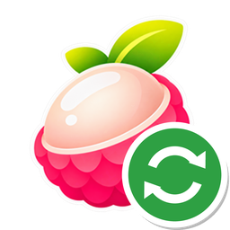

<div align="center">



# Lichii Shader Sync

Downloads shared Vulkan shader cache into Lichii / Eden, so games start with tens of thousands of pipelines instead of building them while you play.

[](https://github.com/oceanpacificpeace/lichii-shader-sync/releases)
[](https://github.com/oceanpacificpeace/lichii-shader-sync/releases/tag/0400486024DEC000-20261107)
[](#use)
[](go.mod)

**[⬇ Download for Windows](https://github.com/oceanpacificpeace/lichii-shader-sync/releases/latest/download/Lichii-Shader-Sync.exe)** &nbsp;·&nbsp; [All downloads](https://github.com/oceanpacificpeace/lichii-shader-sync/releases/latest)

</div>

## Use
1. Boot the game once in your Lichii build (this creates the cache file), then close Lichii.
2. Open **Lichii Shader Sync.exe** and click **Update shaders** (command line: `lichii-sync.exe`). It finds every `vulkan*.fork-vNN.bin` cache for the game, downloads only
   the pipelines you don't have from this repo's latest release, and merges them in.
3. Start the game.

> **Don't turn on `EDEN_NX2_PRELOAD_ALL_PIPELINES` on build 117 or newer.** Those builds evict
> pipelines unused for ~9000 frames (~2.5 min); with a big pack preloaded that throws away tens of
> thousands at once and freezes the game for ~20 s. Leave it off: Lichii builds your recently used
> pipelines at boot and the rest in the background as you reach them. (Older builds such as
> Frizti v3 / build 95 don't evict, so preloading can still help there.)

Options: `lichii-sync sync -launch "C:\path\lichii.exe"` syncs and starts Lichii; `-dry-run` only reports.

## Safety
- Every downloaded chunk is checked against its SHA-256 from the manifest, and every pipeline entry
  is parsed and validated before it is written.
- The merged file is re-validated as a whole before it replaces yours; the previous file is kept as
  `<name>.bak`.
- Lichii must be closed while syncing.

## Compatibility
Works with cache versions v52-v54 (Lichii builds Frizti v3, 95, 117). Shader caches are GPU-independent.

## Publishing (maintainer)
```
lichii-sync pack -title <TITLEID> [-prev <TITLEID>.json] <cache.bin> out/ <TITLEID>-<date>
gh release create <TITLEID>-<date> out/<new chunks>
gh release upload manifests out/<TITLEID>.json --clobber
```
Chunks are append-only: a new pack lists earlier chunks by their original release tag, so only
new chunks need uploading.

## About
An unofficial companion tool; not affiliated with the Lichii or Eden projects. The icon is the
Lichii lychee with a sync badge.
